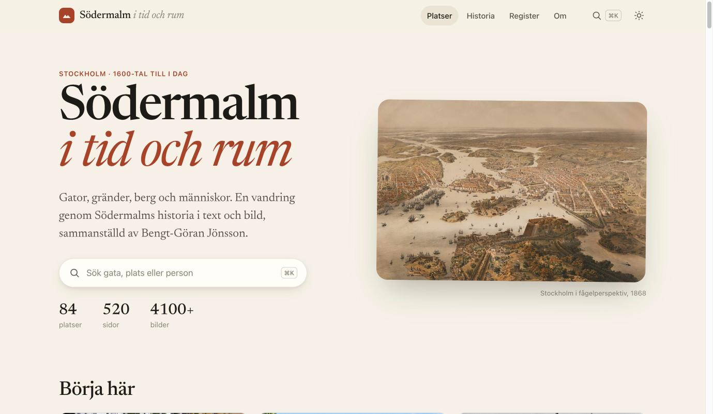

# Södermalm i tid och rum

En läsvänlig guide till Södermalms gator, gränder, berg och människor, byggd på det historiska material som Bengt-Göran Jönsson har sammanställt.



## Om projektet

Originalwebbplatsen består av drygt 500 HTML-sidor från tidigt 2000-tal, med tabellayout, `<font>`-taggar och små miniatyrbilder. Den här versionen behåller allt innehåll men ger det en ny struktur:

- **Text och bild hör ihop.** Varje bild visas med sin bildtext, och bilder som stod bredvid ett stycke i originalet visas fortfarande bredvid det stycket (på mobilen direkt efter det).
- **Riktig typografi.** Stycken, rubriker, källhänvisningar och notiser känns igen och får var sin stil. Serif för läsning, mörkt läge och utskriftsläge.
- **Alla 520 sidor nås.** Varje plats har en innehållsförteckning och bläddring mellan sidorna. Klickbara kartor fungerar, med en lista under kartan för mobilen.
- **Karta** över Södermalm där gatorna är inritade och varje plats har en prick. Tryck på en gata eller prick för att se sidorna om den och alla artiklar där den nämns, med citat. Även gator utan egen sida är klickbara.
- **Sök** (⌘K eller `/`) på platser, sidtitlar, underrubriker och personnamn.
- **Bildvisning** i full storlek med svep, tangentbord och zoom.
- **Fungerar på iOS och webb**, med säkra marginaler, stora tryckytor och snabb laddning (innehållet hämtas per plats först när det behövs).

## Komma igång

Webbplatsen är helt statisk. Öppna `index.html` direkt i webbläsaren, eller starta en lokal server:

```bash
python3 -m http.server
```

Öppna sedan `http://localhost:8000`.

## Uppdatera innehållet

Innehållet byggs från originalsidorna i `source/` och bilderna i `sodermalm.one/`:

```bash
python3 build.py
```

Skriptet kräver `beautifulsoup4` och `lxml` (`pip3 install beautifulsoup4 lxml`). Det läser varje originalsida, tolkar den gamla layouten, kopplar ihop bilder med bildtexter och text, rättar länkar (även skiftläge i filnamn, så att allt fungerar på GitHub Pages) och skriver resultatet till `data/`.

Platsnamn, kategorier, utvalda platser och kortbilder ställs in överst i `build.py`.

### Kartan

Gatornas sträckning och platsernas positioner hämtas från OpenStreetMap och sparas i `data/geo.js`:

```bash
python3 geo.py
```

Kör det bara när en ny plats läggs till. `geo.py` sparar också alla gators sträckning i `source/streets.json`; `build.py` söker sedan igenom texterna efter varje gatunamn (även äldre stavningar, se `ALIASES` i `build.py`) och skriver `data/mentions.js` och `data/streets.js`. Kopplingen mellan plats och gata (eller del av gata, korsning, park) står överst i `geo.py`. Kartbilderna kommer från OpenStreetMap och visas med Leaflet, som laddas först när kartan öppnas.

## Filstruktur

| Sökväg | Innehåll |
|---|---|
| `index.html` | Sidans skal: toppfält, sidfot, sök och bildvisning |
| `style.css` | Designsystemet: färger, typografi, layout, ljust och mörkt läge |
| `app.js` | Routing, vyer, sök och bildvisning |
| `build.py` | Bygger `data/` från originalarkivet |
| `geo.py` | Hämtar kartgeometri till `data/geo.js` |
| `data/index.js` | Platser, sidtitlar, utdrag och sökord (laddas direkt) |
| `data/places/*.js` | Sidinnehållet per plats (laddas vid behov) |
| `data/geo.js` | Gator och punkter för kartan (© OpenStreetMaps bidragsgivare) |
| `source/` | Originalsidorna, orörda, som källa för bygget |
| `sodermalm.one/` | Alla bilder från originalwebbplatsen |

---
*Sammanställt av Bengt-Göran Jönsson. Moderniserat för att bevara Södermalms historia.*
